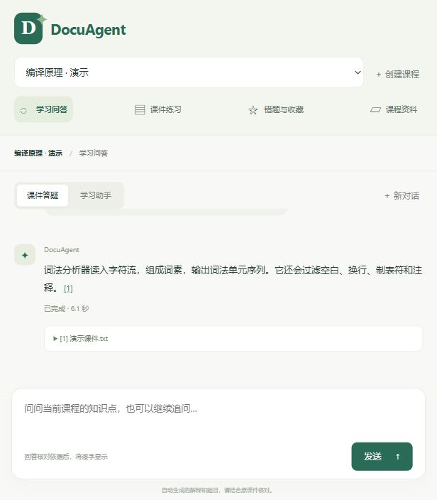
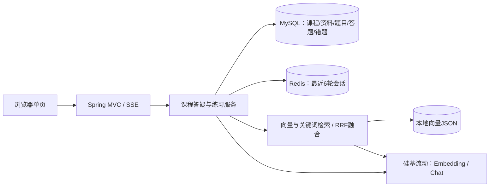
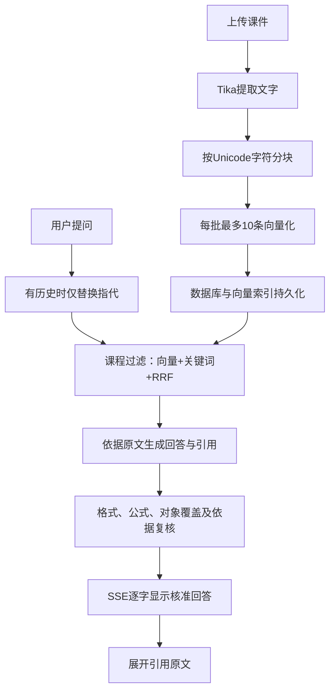
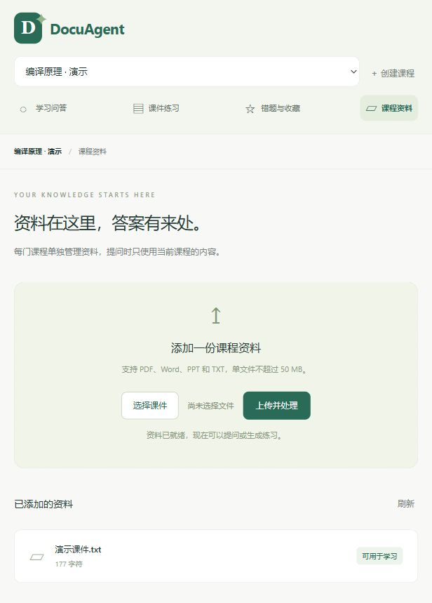
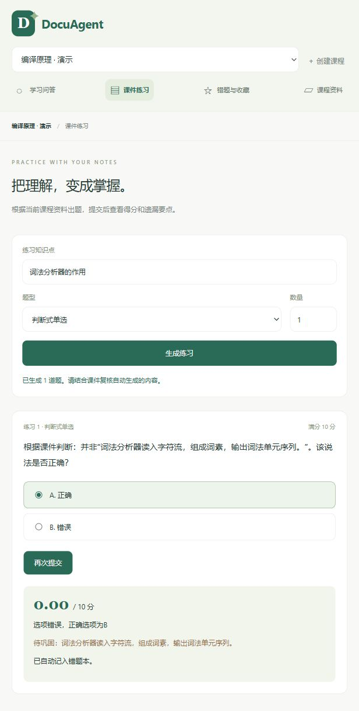
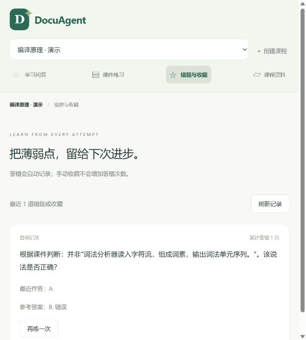

# DocuAgent · 课程资料学习助手

把课程资料变成一个可以追问、出题和批改的学习空间。答案带原文引用；资料没有给出的内容会拒答。面向本地单用户学习与演示。



## 可以做什么

- 按课程上传 PDF、Word、PPT、TXT，自动解析、分块、向量化并保存。
- 根据当前课程回答，点击引用查看原文；支持最近6轮会话与指代替换。
- 生成判断式单选和简答题，选择题本地判分，简答题保留部分分。
- 自动记录错题，重复请求幂等；手动收藏不增加答错次数。
- 学习助手实际调用检索、答题记录查询和手动收藏三个工具。

自动出题与解释需要结合课件复核。当前单选为二选一判断式，不是任意四选项生成器。

## 架构



## RAG流程



SSE采用**校验后逐Unicode字符分段推送**：先完成生成与依据复核，再显示回答；不是供应商原生token直传。首字等待包含生成和复核时间。真实验证收到46个字符事件，首末字符间隔889 ms，见[流式验证](eval/sse-verification.json)。

## 真实评测

2026-10-22，固定25题，六类各至少3题；包括两门均有资料的隔离案例和3种工具失败情景。最终总通过 **19/25**，失败未删除。

|指标|最终构建真实结果|
|---|---|
|Top3检索完整覆盖|9/11（81.8%）|
|资料内回答依据检查|5/11（45.5%）|
|工具调用正确率|6/6（100.0%）|
|平均请求耗时|4969 ms|
|单场景估算成本|￥0.00448452|
|应拒答通过|8/8（100.0%）|
|课程隔离通过|6/6（100.0%）|

成本按输入、输出、Embedding统一￥1/百万token的测算情景计算，**不是硅基流动实时报价或账单**；实际免费额度可能使扣费为0。用量来自供应商返回值，本轮业务用量为输入109510、输出2228、Embedding 375 token。单场景成本含多轮历史准备；平均请求耗时仅计主请求往返，完整场景平均为5589 ms。辅助检索探针、索引重建用量另记。

依据指标为保守自动规则：答案要点、引用原文锚点、符号对象与课程范围；不是完整语义准确率，跨块/数学字体还可能造成假阴性。详见[全量基线与最终复验](eval/baseline-v2.md)、[逐参数对照](eval/tuning-log.md)、[固定题集](eval/questions-v2.json)。

最终参数：Unicode分块500、overlap=0，答疑TopK=10，重排关闭。本轮最有收益的是overlap，但这是当前课件与题集的单次对照结论。四组对照后选中组合曾为6/11，最终复验为5/11；没有用高分覆盖波动。仍有FIRST/FOLLOW、正则比较和跨文档引用等6题未通过。

## 本地启动（Windows）

### 1. 准备环境

使用JDK 17、Maven、MySQL 8、Redis，以及能访问聊天和Embedding模型的硅基流动Key。锁定版本：Spring Boot 3.5.13、Spring AI 1.1.8、MyBatis-Plus 3.5.17；聊天Qwen/Qwen3-8B，Embedding BAAI/bge-m3（1024维）。

### 2. 在DataGrip初始化数据库

连接本机MySQL，打开[sql/init.sql](sql/init.sql)，**Ctrl+A，再Ctrl+Enter**执行完整脚本。默认数据库docuagent。脚本仅CREATE，可重复执行。已有段2数据库无需清空；缺少批改结果列的旧库可按[业务说明](docs/业务闭环.md)补列。

### 3. 配置自己的凭证

从项目根目录执行：

```powershell
New-Item -ItemType Directory -Force .local | Out-Null
Copy-Item config/application-secrets.properties.example .local/application-secrets.properties
notepad .local/application-secrets.properties
```

把文件里的两个replace-with占位值换成自己的MySQL密码和硅基流动Key，保留外层环境变量表达式。该目录被Git忽略。也可以只在当前终端设置DB_PASSWORD、AI_API_KEY环境变量。可选DB_USER、DB_URL、REDIS_HOST、REDIS_PORT、APP_PORT。

### 4. 运行

先启动MySQL和Redis，然后执行：

```powershell
.\start.bat
```

打开[http://localhost:18081/index.html](http://localhost:18081/index.html)。首次运行若没有JAR，脚本会构建；启动脚本优先使用DOCUAGENT_JAVA_HOME或本机E:\jdk17，其次JAVA_HOME，并检查Java 17。

新目录不含私人课件、向量或凭证，首次启动课程列表为空。创建课程，上传自己的资料即可。要复现界面演示，可上传[演示课件.txt](eval/fixtures/演示课件.txt)。

修改代码后，先Ctrl+C停止旧服务，再运行：

```powershell
$env:JAVA_HOME='E:\jdk17'
mvn package
.\start.bat
```

本次完整构建37项测试通过，包含真实Redis窗口和HTTP SSE测试。构建测试需要本机MySQL、Redis和上述配置可用。

## 从资料到错题

1. 创建课程，在“课程资料”上传课件，等待“可用于学习”。
2. 在“课件答疑”提问，观察逐字显示；点击引用编号展开原文。
3. 在“课件练习”选择知识点、题型和数量，生成题目。
4. 提交答案，查看得分、已掌握和待巩固要点。
5. 在“错题与收藏”查看记录，点“再练一次”继续练习。

学习助手模式可以查最近答题情况，或明确指定题号收藏。无效题号、跨课程收藏、越界时间范围均有失败验收。





## 资料与持久化

- MySQL保存结构化业务，Redis保存最近6轮完整会话（7天TTL）。
- 上传文件保存在upload/，向量保存在data/vector-store.json，启动时加载。
- 更改Embedding模型/维度或分块参数后需要重建已有索引；只改配置不会追溯重切旧资料。
- 本轮在独立docuagent_eval_*库和索引对照，随后停服、完整备份再应用所选分块；备份在本机data/backups。原始课件文件保留。

接口用法见[业务闭环](docs/业务闭环.md)，流式约定见[SSE说明](docs/SSE说明.md)，署名与参考见[参考资料](docs/参考资料.md)。[交付验收记录](docs/交付验收.md)记录浏览器与新目录启动的实测结果。
