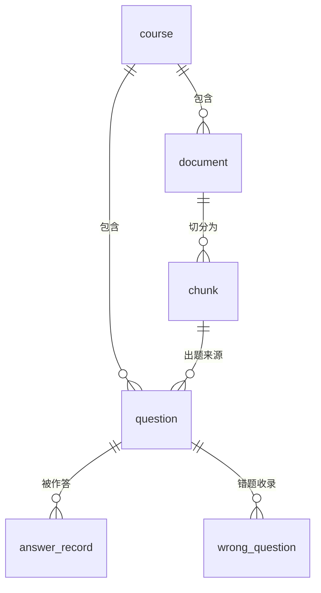

# DocuAgent · 数据库设计（ER 图）

> 库名：`docuagent`｜字符集：`utf8mb4`｜引擎：InnoDB
> 建表脚本：[`../sql/init.sql`](../sql/init.sql)（**只含 CREATE TABLE，可重复执行**）

---

## 一、表关系

---

## 二、表清单

| # | 表 | 说明 | 字段数 |
|---|---|---|---|
| 1 | `course` | 课程 | 6 |
| 2 | `document` | 课件 | 11 |
| 3 | `chunk` | 分块（检索的最小单位）| 8 |
| 4 | `question` | 题目 | 11 |
| 5 | `answer_record` | 答题记录 | 12 |
| 6 | `wrong_question` | 错题本 | 9 |

---

## 三、字段明细

### 1. course · 课程

| 字段 | 类型 | 说明 |
|---|---|---|
| `id` | BIGINT PK AUTO_INCREMENT | 课程ID |
| `name` | VARCHAR(100) | 课程名称 |
| `description` | VARCHAR(500) | 课程介绍 |
| `create_time` | DATETIME | 创建时间 |
| `update_time` | DATETIME | 更新时间 |
| `deleted` | TINYINT | 逻辑删除：0未删 1已删 |

### 2. document · 课件

| 字段 | 类型 | 说明 |
|---|---|---|
| `id` | BIGINT PK AUTO_INCREMENT | 课件ID |
| `course_id` | BIGINT → `course.id` | 所属课程 |
| `original_name` | VARCHAR(255) | 原始文件名 |
| `storage_path` | VARCHAR(500) | 存储路径（相对路径）|
| `file_type` | VARCHAR(20) | pdf / ppt / pptx / docx |
| `file_size` | BIGINT | 文件大小（字节）|
| `status` | VARCHAR(20) | UPLOADED / PARSING / INDEXING / DONE / FAILED |
| `failure_reason` | VARCHAR(1000) | 失败原因（仅 FAILED 时有值）|
| `char_count` | INT | 提取出的字符数（解析成功后填）|
| `create_time` / `update_time` | DATETIME | |
| `deleted` | TINYINT | 逻辑删除 |

**索引**：`idx_document_course_id (course_id)`

### 3. chunk · 分块

| 字段 | 类型 | 说明 |
|---|---|---|
| `id` | BIGINT PK AUTO_INCREMENT | 分块ID |
| `document_id` | BIGINT → `document.id` | 所属课件 |
| `chunk_index` | INT | 在原文中的序号（从 0 开始）|
| `content` | TEXT | 分块原文 |
| `char_count` | INT | 字符数 |
| `create_time` / `update_time` | DATETIME | |
| `deleted` | TINYINT | 逻辑删除 |

**索引**：`idx_chunk_document_id (document_id)`

> 📌 `document_id` + `chunk_index` 一起用，才能**从检索结果回到原文位置** —— 这是引用溯源的底层支撑。

### 4. question · 题目

| 字段 | 类型 | 说明 |
|---|---|---|
| `id` | BIGINT PK AUTO_INCREMENT | 题目ID |
| `course_id` | BIGINT → `course.id` | 所属课程 |
| `type` | VARCHAR(20) | `single_choice` / `short_answer` |
| `stem` | TEXT | 题干 |
| `options` | VARCHAR(1000) | 选项（JSON 数组字符串，仅选择题）|
| `answer` | VARCHAR(500) | 参考答案 |
| `key_points` | VARCHAR(1000) | 评分要点（批改逐条比对用）|
| `source_chunk_id` | BIGINT → `chunk.id` | 出题来源（批改引用的依据）|
| `create_time` / `update_time` | DATETIME | |
| `deleted` | TINYINT | 逻辑删除 |

**索引**：`idx_question_course_id (course_id)`

### 5. answer_record · 答题记录

| 字段 | 类型 | 说明 |
|---|---|---|
| `id` | BIGINT PK AUTO_INCREMENT | 答题记录ID |
| `question_id` | BIGINT → `question.id` | 题目ID |
| `user_answer` | TEXT | 用户提交的答案 |
| `score` | DECIMAL(5,2) | 得分 |
| `max_score` | DECIMAL(5,2) | 满分 |
| `is_correct` | TINYINT | 0否 1是 |
| `comment` | VARCHAR(1000) | 批改评语 |
| `duration_ms` | INT | 答题耗时（毫秒）|
| `request_id` | VARCHAR(64) | 请求ID（**幂等去重用**）|
| `create_time` / `update_time` | DATETIME | |
| `deleted` | TINYINT | 逻辑删除 |

**索引**：`idx_answer_record_question_id (question_id)`、**`uk_answer_record_request_id (request_id)` UNIQUE**

> 📌 唯一索引是**幂等的最后一道防线**：同一请求重发时，数据库直接拒绝第二条。
> 📌 `score` 用 **DECIMAL 不用 FLOAT**（0.1+0.2 那种精度坑），Java 侧用 `BigDecimal` 接。

### 6. wrong_question · 错题本

| 字段 | 类型 | 说明 |
|---|---|---|
| `id` | BIGINT PK AUTO_INCREMENT | 错题记录ID |
| `question_id` | BIGINT → `question.id` | 题目ID |
| `wrong_count` | INT | 答错次数（**仅 auto 来源累加**）|
| `source` | VARCHAR(20) | `auto` 批改自动入库 / `manual` 手动收藏 |
| `first_wrong_time` | DATETIME | 首次答错时间 |
| `last_wrong_time` | DATETIME | 最近答错时间 |
| `create_time` / `update_time` | DATETIME | |
| `deleted` | TINYINT | 逻辑删除 |

**索引**：**`uk_wrong_question_question_id (question_id)` UNIQUE**

> 📌 唯一索引保证**同一道题永远只有一行**：再错只能 `wrong_count + 1`，不可能长出第二行。
> 📌 `source = manual`（模型调工具手动收藏）**不累加 `wrong_count`**。

---

## 四、通用约定

- **每张表都带** `create_time` / `update_time` / `deleted`
- `update_time` 由 MySQL 的 `ON UPDATE CURRENT_TIMESTAMP` 自动维护，**代码不用管**
- `deleted` 配合 MyBatis-Plus 全局逻辑删除（`logic-delete-field: deleted`）—— **代码里 `delete()` 会自动变成 UPDATE**
- 主键统一 `BIGINT AUTO_INCREMENT`
- 字段命名用**下划线**，Java 侧靠 `map-underscore-to-camel-case` 自动映射
